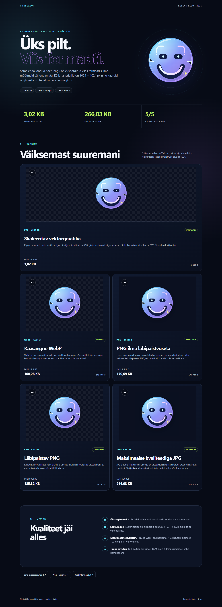

# Pildifaili formaadid ja suuruse optimeerimine

Õppeülesanne, milles sama enda loodud SVG-naerunägu on võrreldud viies failiformaadis. Kõik rasterpildid on eksporditud mõõdus **1024 × 1024 px** ilma mõõtmeid vähendamata.

## Tulemused

Failid on järjestatud väiksemast suuremani. Arvutuses on kasutatud seost **1 KB = 1024 B**.

| Koht | Formaat | Omadus | Baiti | Suurus |
|---:|---|---|---:|---:|
| 1 | SVG | vektor, läbipaistev | 3 088 B | 3,02 KB |
| 2 | WebP | kadudeta, läbipaistev | 102 688 B | 100,28 KB |
| 3 | PNG | kadudeta, ilma läbipaistvuseta | 174 783 B | 170,69 KB |
| 4 | PNG | kadudeta, läbipaistev | 189 763 B | 185,32 KB |
| 5 | JPG | kvaliteet 100, 4:4:4 | 272 417 B | 266,03 KB |

## Failid

- `index.html` — valmis responsiivne võrdlusleht
- `pilt.svg` — algne enda loodud vektorillustratsioon
- `pilt.webp` — kadudeta WebP läbipaistvusega
- `pilt-labi.png` — läbipaistev PNG
- `pilt-mitte.png` — läbipaistmatu PNG
- `pilt.jpg` — JPG maksimaalse kvaliteediga
- `preview.png` ja `preview-mobile.png` — töölaua- ja mobiilivaate kontrollpildid

## Kvaliteet

- Rasterfailide mõõtmed: 1024 × 1024 px
- PNG: kadudeta pakkimine
- WebP: lossless, kvaliteet 100, alfakvaliteet 100
- JPG: kvaliteet 100 ja 4:4:4 värvivalim
- Kontrollitud töölaual 1440 px ja mobiilis 390 px

Koostaja: **Ruslan Rebo**
